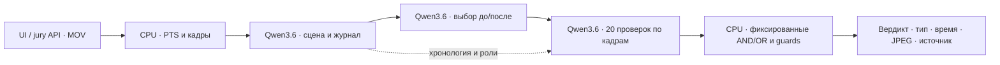

# Финальная архитектура · 2026.10.18-final.1

Один и тот же `app/release/engine.py` используется сервисом и полным benchmark. На CPU нет детекторов, pose, face recognition, локальной LLM или обращения к сторонним AI API. Все визуальные запросы идут к Qwen3.6 на GPU команды через OpenAI-совместимый endpoint. Идентичность человека не устанавливается; роли функциональные, внутри конкретного видео.

1. MOV проверяется ffprobe: до 128 MiB / 180 с / 4096×2160. PyAV последовательно декодирует исходные PTS. Общий обзор — 2,5 кадра/с, пул деталей — 5 кадров/с, максимальная сторона 1024 px. Звук не используется.
2. Восемь обзорных кадров дают карту сцены: люди, функциональные роли и зоны, сейф, экран, неопределённости. Сторона двери и направление взгляда сами по себе не задают роль.
3. Перекрывающиеся окна по 7 кадров (шаг 6) дают неизменяемый журнал действий, видимые переходы и тип операции. Отдельно отмечается, подтверждена ли операция с клиентом. Отсутствие клиента не превращает внутренний пересчёт в приём наличных без идентификации.
4. Qwen получает хронологию всего видео и выбирает моменты для каждого из 20 критериев, без меток, имени файла и времени из таблицы. На длинных роликах проверка получает до 24 релевантных окон, включая равномерно распределённые и соседние с выбранным моментом.
5. Каждый критерий проверяется повторно по исходным кадрам до/во время/после. Пакет содержит до 9 полных кадров и 7 кропов с шагом 0,2 с. Для ключей кроп охватывает верх и переднюю часть сейфа. Увеличение Lanczos до 4× не создаёт отсутствующие детали. При вырожденном выборе времени используется пик изменения пикселей ROI, а не разметка.
6. Ответ содержит только статусы фиксированных фактов (`supported`, `contradicted`, `unknown`) и ID реально показанных изображений. AND/OR вычисляет код. Модель не может добавить новое обязательное условие или отменить вычисленный результат свободным финальным ответом. Проверяются последовательность и видимая применимость операции/границ зон.
7. Итоговый API имеет два verdict. `unknown` отдельно сохраняется в `review_candidates` и не становится подтверждённым нарушением. Сбой или timeout — `failed`, а не `no_violation`. Для подтверждённого типа выдаются 1–3 реальных JPEG, исходные таймстемпы и нормативная ссылка.

Во всех запросах `temperature=0`, `seed=17`, `enable_thinking=false`, строгая JSON Schema; gateway также принудительно отключает thinking. Четыре запроса к модели параллельно. Сервис принимает одно видео одновременно, повторный запрос получает 429: очередь не расходует лимит 5 минут. Процесс обработки принудительно завершается через 270 секунд; исходное видео удаляется. Результаты обычных загрузок хранятся 24 часа, закрытая галерея учебных примеров — отдельно.

## Что проверено и что ограничено

Система не обучалась на 42 роликах, но критерии и промпты разработаны с использованием их аннотаций. Это development-набор, а не независимая оценка обобщения. Мелкие ключи, цифровая идентификация вне кадра, активность сессии ноутбука и принадлежность наличных могут быть неразличимы. Unknown не доказывает нормальное поведение. Новые типы вне каталога пока требуют расширения схемы. Снижение порога до «всё подозрительное — нарушение» искусственно повышает Recall и не используется.

Ранее детальный проход по ключам на шести роликах не повысил их type Recall (0/2); многократный скан сейфа поэтому не включён. Умеренные крупные планы сохранены. YOLO26n также не включён в финальный путь: дополнительная детекция не дала подтверждённого преимущества по правильному типу.

## Развёртывание и локальность

CPU: FastAPI, SQLite, PyAV, Pillow; модель: существующий Qwen3.6-35B-A3B FP8 под alias `qwen`, vLLM на GPU команды. `/v1/models` подтверждает alias и контекст 32768, но alias сам по себе не доказывает точное происхождение весов. Воспроизводимый запуск требует сохранить идентификатор/ревизию именно установленных весов и совместимую сборку vLLM.

Демо связывает два сервера команды через защищённый HTTPS tunnel ngrok. Это транспорт, не внешняя AI модель; однако tunnel требует Интернет и живых обоих серверов. Для автономной сдачи предусмотрен `MODEL_URL=http://127.0.0.1:9003/v1` на одном GPU хосте либо частный LAN endpoint с явным allowlist. Полностью автономный запуск текущего окружения без Интернета не был испытан. Docker profile описывает упаковку CPU приложения; Docker build и установка совместимого vLLM требуют заранее подготовленных зависимостей. Нельзя заявлять offline соответствие только по наличию конфигурации.
